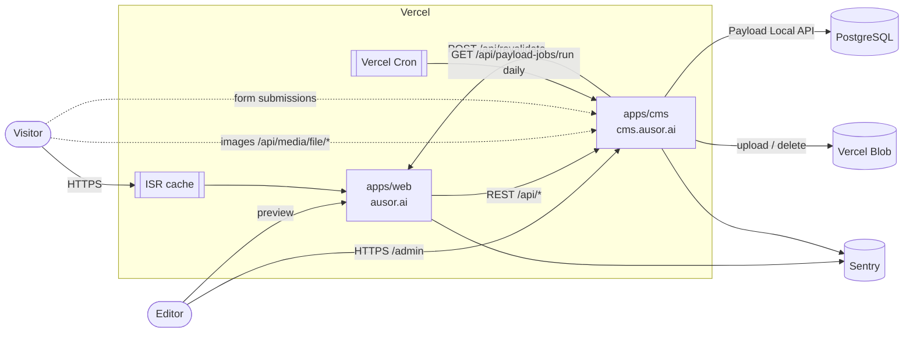
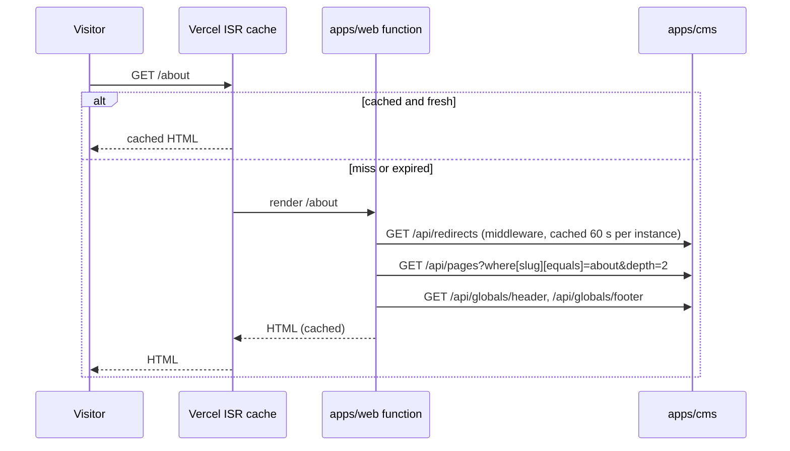
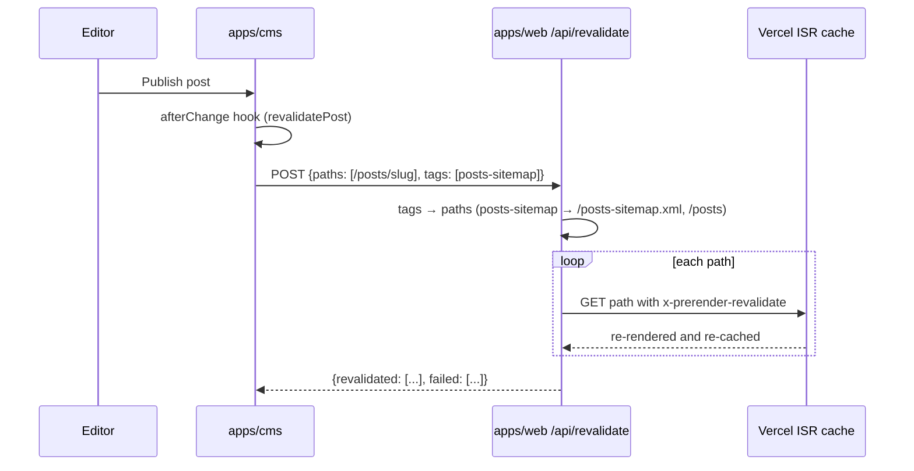
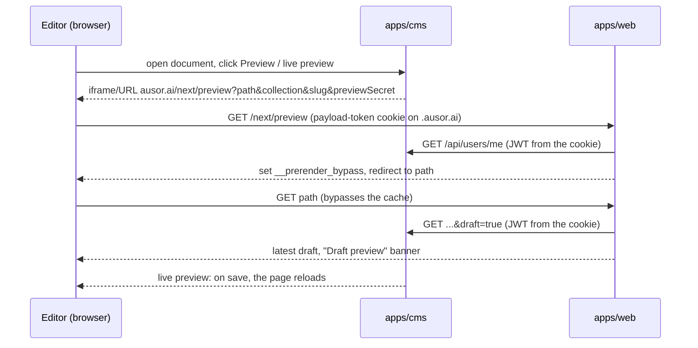

# Architecture

Zeus is a Bun workspace with two apps that are deployed separately: a Payload CMS on Next.js and a public website built with Astro. The CMS owns the PostgreSQL database and the Vercel Blob store; the website reads content from the CMS REST API.

| App | Path | Domain | Serves |
|---|---|---|---|
| CMS | `apps/cms` | `cms.ausor.ai` | Payload admin (`/admin`), REST/GraphQL API (`/api/*`), uploaded media (`/api/media/file/*`), form submissions, scheduled jobs |
| Website | `apps/web` | `ausor.ai` | Public pages, posts, search, sitemaps, draft preview (`/next/preview`), on-demand revalidation (`/api/revalidate`) |
| Shared | `packages/core` | — | Payload config, collections, globals, block and field schemas, admin components, migrations, `payload-types.ts`, shared `next.config` for the CMS |

## Technology stack

| Layer | Technology |
|---|---|
| Runtime | Node.js 26.13.0, Bun 1.4.4 (package manager and script runner) |
| CMS framework | Next.js 16 (App Router, Turbopack), React 19 |
| CMS | Payload 3 (`@payloadcms/next`, Lexical rich text) |
| Payload plugins | redirects, nested-docs, SEO, form-builder, search, Vercel Blob storage, Payload Cloud |
| Database | PostgreSQL via `@payloadcms/db-postgres` (connection string `POSTGRES_URL`) |
| File storage | Vercel Blob (`@payloadcms/storage-vercel-blob`) |
| Website framework | Astro 7, server output with `@astrojs/vercel` (Vercel Functions + ISR) |
| Website UI | Tailwind CSS 4, daisyUI 5 (light/dark themes), Geist font; rich text rendered to HTML with `@payloadcms/richtext-lexical/html` |
| Hosting | Vercel (two projects), optional Docker image for the CMS |
| Observability | Sentry (`@sentry/nextjs` on the CMS, `@sentry/astro` on the website), Vercel Analytics, Vercel Speed Insights, Checkly (configured, see [KNOWN_ISSUES.md](./KNOWN_ISSUES.md)) |
| CI | GitHub Actions (lint, type check, CodeQL) |

## System context



## Code layout

```
apps/
  cms/                   Next.js app for cms.ausor.ai
    src/app/(payload)/   admin, REST, GraphQL, seed route (generated by Payload)
    next.config.mjs      redirect / → /admin; requires NEXT_PUBLIC_SERVER_URL in production
    vercel.json          build command, daily jobs cron, function limits
  web/                   Astro app for ausor.ai
    astro.config.mjs     server output, Vercel adapter (ISR), Sentry, Tailwind; requires NEXT_PUBLIC_CMS_URL and REVALIDATION_SECRET in production
    src/pages/           routes: pages, posts, search, sitemaps, robots.txt, /next/preview, /api/revalidate
    src/components/      Astro versions of the header, footer, heros and blocks
    src/lib/             cms.ts (REST client), draft.ts, richtext.ts, media, links, SEO, sitemaps
    src/middleware.ts    redirects collection and /admin → CMS
    scripts/             post-build fix of the Vercel function runtime
packages/
  core/
    next.config.base.mjs createNextConfig(): Payload + Sentry wrapping, standalone output, monorepo tracing (CMS)
    src/                 payload.config.ts and everything the content model needs (see DESIGN.md)
```

The CMS imports shared code through the `@/*` alias (→ `packages/core/src/*`) and the Payload config through `@payload-config`. The website only imports types (`@zeus/core/payload-types`) and plain data from `packages/core`, through the `@zeus/core/*` alias. `bunfig.toml` forces the hoisted linker so Payload, React and Next.js resolve to a single copy for every workspace.

## How the two apps talk to each other

- **Reading content.** The website calls the CMS REST API (`${NEXT_PUBLIC_CMS_URL}/api/...`) from server code in `src/lib/cms.ts`, with explicit `depth` and `limit` on every request. Anonymous requests only see published documents. The website has no database access and no Payload secret. Redirects from the CMS are not followed, so a CMS behind Vercel Deployment Protection fails with a clear error; `CMS_PROTECTION_BYPASS` lets the website through.
- **Caching.** Every website route is rendered on demand and cached by Vercel ISR. Routes that depend on the query string or cookies (`/search`, `/next/*`, `/api/*`) are excluded. A cached page expires after 600 seconds at the latest.
- **Cache revalidation.** Payload hooks call `revalidateFrontend()`, which POSTs `{ paths, tags }` to `${NEXT_PUBLIC_SERVER_URL}/api/revalidate` with `Authorization: Bearer ${REVALIDATION_SECRET}`. The website maps tags to paths and requests each path with the ISR bypass token, which replaces the cached copy. Failures are logged and never block a save.
- **Media.** Uploads live in Vercel Blob and are served by the CMS at relative URLs (`/api/media/file/...`), which the website prefixes with `NEXT_PUBLIC_CMS_URL`. The website builds `srcset` from Payload's generated sizes and loads the images directly from the CMS (there is no image optimization step any more).
- **Live preview and the Preview button** point at `${NEXT_PUBLIC_SERVER_URL}/next/preview`. That route checks `PREVIEW_SECRET` and the editor's admin session (`payload-token` cookie, verified with `/api/users/me`), then sets Vercel's `__prerender_bypass` cookie. In draft mode pages skip the cache and read drafts with the editor's own token. In production the CMS sets the session cookie on `COOKIE_DOMAIN=.ausor.ai` so that the website receives it.
- **Browser calls to the CMS** (form submissions, live preview messages) go to `NEXT_PUBLIC_CMS_URL`; the Payload `cors` setting allows the website and CMS origins.

## Key request flows

### Visitor views a page



### Editor publishes a change



| Tag | Paths re-rendered |
|---|---|
| `pages-sitemap` | `/pages-sitemap.xml` |
| `posts-sitemap` | `/posts-sitemap.xml`, `/posts` |
| `global_header`, `global_footer`, `redirects` | every published page and post, `/posts`, `/posts/page/N` |

### Editor previews a draft



## Environments

| Environment | Git branch | Website | CMS | Notes |
|---|---|---|---|---|
| Local | any | `http://localhost:3000` | `http://localhost:3001` | Cookies on `localhost` are shared across ports, so preview works without `COOKIE_DOMAIN`. ISR does not run locally. |
| Preview | `preview` | `preview.ausor.ai` (and Vercel preview URLs) | Vercel preview URL of the CMS project | Protected by Vercel Authentication; the website needs `CMS_PROTECTION_BYPASS` to read the CMS |
| Production | `main` | `ausor.ai` (`www.ausor.ai` redirects) | `cms.ausor.ai` | `COOKIE_DOMAIN=.ausor.ai`; the CMS must not be behind Deployment Protection |

The `development` branch is not deployed. See [DEPLOYMENT.md](./DEPLOYMENT.md) for the Vercel projects and [CONFIGURATION.md](./CONFIGURATION.md) for the environment variables.

## Design decisions

| Decision | Reason | Consequence |
|---|---|---|
| Split CMS and website into two apps in one repository | Deploy, scale and secure the admin separately from the public site while keeping one content model | Cross-app revalidation, shared cookie domain and CORS are required |
| Website built with Astro instead of Next.js (October 2026, following the `athena` project) | Ships almost no JavaScript to visitors; the public site no longer carries Payload, React or the database driver | Blocks and heros exist as Astro components in `apps/web`; a new block needs a Payload config in `packages/core` and an Astro component |
| Website reads the CMS over REST instead of the database | The website needs no database credentials or Payload secret, and a website deploy cannot break the schema | Every uncached render depends on the CMS being up; header and footer degrade to no navigation, sitemaps return 503 |
| ISR with on-demand revalidation instead of static generation | Publishing must show up within seconds without a rebuild; draft preview needs per-request rendering | Pages that list other documents (archive blocks, post lists) refresh within the 600 s expiration |
| Draft preview uses the editor's own CMS session | No service account or extra secret on the website | Preview only works where the website receives the admin cookie (localhost, or `*.ausor.ai` with `COOKIE_DOMAIN`) |
| Shared code lives in `packages/core` | One Payload config and one set of generated types | The website must import only types and plain data from it |
