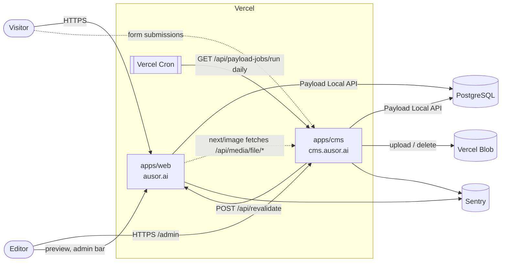
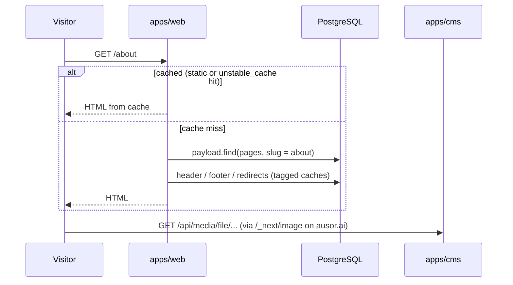
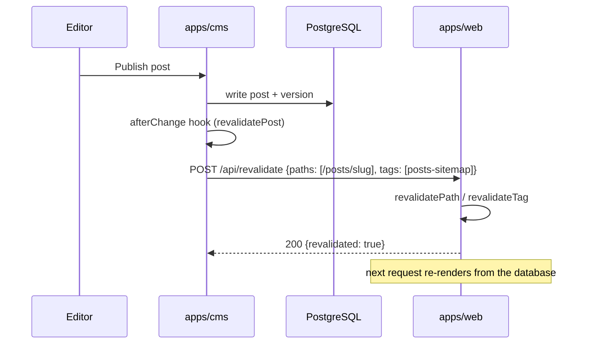
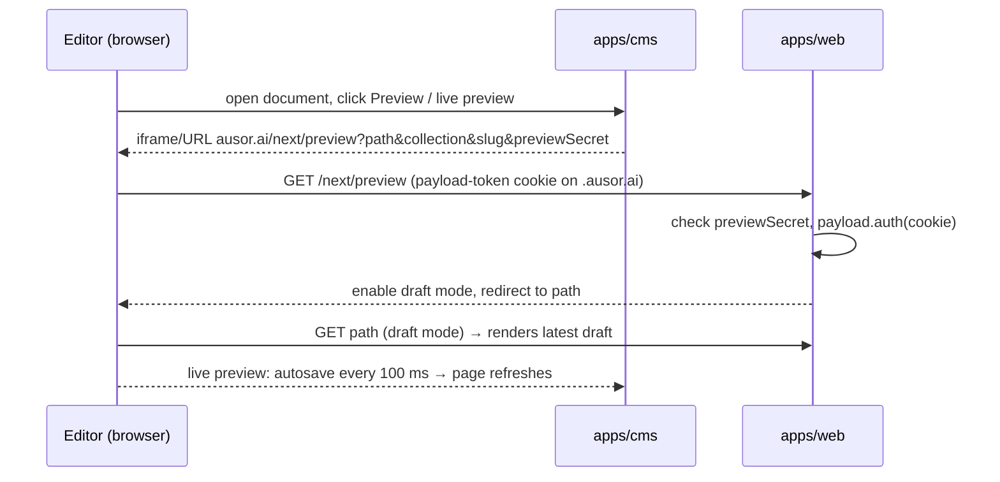

# Architecture

Zeus is a Bun workspace with two Next.js apps that are deployed separately and share one Payload CMS configuration, one PostgreSQL database and one Vercel Blob store.

| App | Path | Domain | Serves |
|---|---|---|---|
| CMS | `apps/cms` | `cms.ausor.ai` | Payload admin (`/admin`), REST/GraphQL API (`/api/*`), uploaded media (`/api/media/file/*`), scheduled jobs |
| Website | `apps/web` | `ausor.ai` | Public pages, posts, search, sitemaps, draft preview (`/next/preview`), on-demand revalidation (`/api/revalidate`) |
| Shared | `packages/core` | — | Payload config, collections, globals, blocks, components, utilities, migrations, `payload-types.ts`, shared `next.config` |

## Technology stack

| Layer | Technology |
|---|---|
| Runtime | Node.js 24.22.1, Bun 1.4.4 (package manager and script runner) |
| Framework | Next.js 16 (App Router, Turbopack), React 19 |
| CMS | Payload 3 (`@payloadcms/next`, Lexical rich text) |
| Payload plugins | redirects, nested-docs, SEO, form-builder, search, Vercel Blob storage, Payload Cloud |
| Database | PostgreSQL via `@payloadcms/db-postgres` (connection string `POSTGRES_URL`) |
| File storage | Vercel Blob (`@payloadcms/storage-vercel-blob`) |
| UI | Tailwind CSS 3, Radix UI primitives, shadcn-style components, Geist font, lucide icons |
| Hosting | Vercel (two projects), optional Docker image per app |
| Observability | Sentry (`@sentry/nextjs`), Vercel Analytics, Vercel Speed Insights, Checkly (configured, see [KNOWN_ISSUES.md](./KNOWN_ISSUES.md)) |
| CI | GitHub Actions (lint, type check, CodeQL) |

## System context



## Code layout

```
apps/
  cms/                 Next.js app for cms.ausor.ai
    src/app/(payload)/ admin, REST, GraphQL, seed route (generated by Payload)
    next.config.mjs    redirect / → /admin; requires NEXT_PUBLIC_SERVER_URL in production
    vercel.json        build command, daily jobs cron, function limits
  web/                 Next.js app for ausor.ai
    src/app/(frontend)/ pages, posts, search, sitemaps, preview routes
    src/app/api/revalidate/ on-demand revalidation endpoint
    next.config.mjs    redirect /admin → CMS; image host = CMS; requires NEXT_PUBLIC_CMS_URL in production
    next-sitemap.config.cjs, tailwind.config.mjs, public/
packages/
  core/
    next.config.base.mjs  createNextConfig(): Payload + Sentry wrapping, standalone output, monorepo tracing
    src/                  payload.config.ts and everything both apps share (see DESIGN.md)
```

Both apps import shared code through the `@/*` alias (→ `packages/core/src/*`) and the Payload config through `@payload-config` (→ `packages/core/src/payload.config.ts`). `bunfig.toml` forces the hoisted linker so Payload, React and Next.js resolve to a single copy for every workspace.

## How the two apps talk to each other

- **Reading content.** The website reads content with Payload's Local API (`getPayload({ config })`) straight from the same Postgres database, so it needs the same `POSTGRES_URL`, `PAYLOAD_SECRET` and `BLOB_READ_WRITE_TOKEN` as the CMS. It does not render the admin panel or expose the Payload API.
- **Cache revalidation.** Payload hooks run inside the CMS, where `revalidatePath`/`revalidateTag` would only clear the CMS's own cache. The hooks call `revalidateFrontend()` instead, which POSTs `{ paths, tags }` to `${NEXT_PUBLIC_SERVER_URL}/api/revalidate` with `Authorization: Bearer ${REVALIDATION_SECRET}`. Failures are logged and never block a save.
- **Media.** Media URLs stay relative (`/api/media/file/...`) in the database. `getMediaUrl()` prefixes them with `NEXT_PUBLIC_CMS_URL`, and the website's `next/image` config allows that host.
- **Live preview and the Preview button** point at `${NEXT_PUBLIC_SERVER_URL}/next/preview`. That route checks `PREVIEW_SECRET` and the admin session cookie, so in production the CMS sets the cookie on `COOKIE_DOMAIN=.ausor.ai` and both subdomains can read it.
- **Browser calls to the CMS** (form submissions, the admin bar's `/api/users/me`, live preview messages) go to `NEXT_PUBLIC_CMS_URL`; the Payload `cors` setting allows the website and CMS origins.

## Key request flows

### Visitor views a page



### Editor publishes a change



### Editor previews a draft



## Environments

| Environment | Git branch | Website | CMS | Notes |
|---|---|---|---|---|
| Local | any | `http://localhost:3000` | `http://localhost:3001` | Cookies on `localhost` are shared across ports, so preview works without `COOKIE_DOMAIN` |
| Preview | `preview` | `preview.ausor.ai` (and Vercel preview URLs) | Vercel preview URL of the CMS project | Protected by Vercel Authentication |
| Production | `main` | `ausor.ai` (`www.ausor.ai` redirects) | `cms.ausor.ai` | `COOKIE_DOMAIN=.ausor.ai` |

The `development` branch is not deployed. See [DEPLOYMENT.md](./DEPLOYMENT.md) for the Vercel projects and [CONFIGURATION.md](./CONFIGURATION.md) for the environment variables.

## Design decisions

| Decision | Reason | Consequence |
|---|---|---|
| Split CMS and website into two apps in one repository | Deploy, scale and secure the admin separately from the public site while keeping one content model | Cross-app revalidation, shared cookie domain and CORS are required |
| Website reads the database directly (Local API) instead of calling the CMS over HTTP | No extra network hop, full type safety, works during static generation | The website needs database and Payload secrets; both apps must run compatible schema versions |
| Shared code lives in `packages/core`, compiled by each app | One Payload config and one set of components | Both apps rebuild when `packages/core` changes |
| Media stays on relative URLs served by the CMS | Media survives domain changes; Blob tokens stay server-side | Images on the website depend on the CMS being up (the `next/image` cache softens this) |
