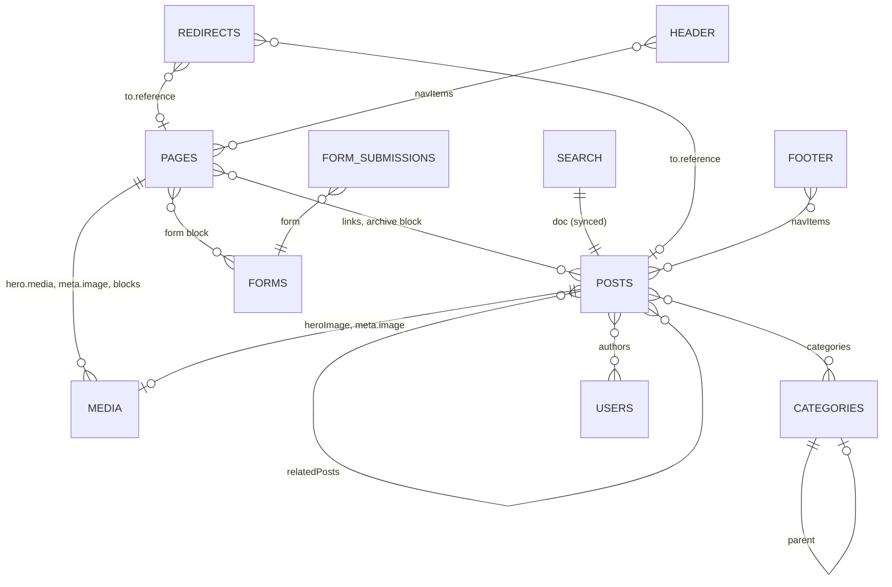

# Data model

The content model is defined once in `packages/core/src/payload.config.ts` and used by both apps. Payload's Postgres adapter maps it to tables in the `public` schema. Generated TypeScript types live in `packages/core/src/payload-types.ts`.

## Overview

## Collections

### Defined in this repository

| Slug | Purpose | Versions / drafts | Admin title |
|---|---|---|---|
| `pages` | Website pages built from a hero and blocks | Drafts, autosave 100 ms, scheduled publish, 50 versions | `title` |
| `posts` | Blog posts | Drafts, autosave 100 ms, scheduled publish, 50 versions | `title` |
| `media` | Uploaded images and files | — | filename |
| `categories` | Post categories, nestable | — | `title` |
| `users` | CMS accounts (auth enabled) | — | `name` |

### Added by plugins

| Slug | Plugin | Purpose |
|---|---|---|
| `redirects` | `@payloadcms/plugin-redirects` | `from` path → page, post or custom URL |
| `forms` | `@payloadcms/plugin-form-builder` | Form definitions, confirmation, e-mail notifications |
| `form-submissions` | `@payloadcms/plugin-form-builder` | Submitted values per form |
| `search` | `@payloadcms/plugin-search` | Search index synced from published posts |

Payload also keeps internal tables: `payload_jobs`, `payload_jobs_log`, `payload_kv`, `payload_locked_documents(_rels)`, `payload_preferences(_rels)`, `payload_migrations` and `users_sessions`.

## Access control

| Collection | read | create / update / delete |
|---|---|---|
| `pages`, `posts` | Signed-in users: all; visitors: only `_status = published` | Signed-in users |
| `media`, `categories` | Anyone | Signed-in users |
| `users` | Signed-in users (also required to open the admin) | Signed-in users |
| `header`, `footer` (globals) | Anyone | Signed-in users |
| `redirects`, `forms` | Anyone (plugin default) | Signed-in users |
| `search` | Anyone (plugin default) | Written only by the search plugin's sync (create is disabled); signed-in users may update/delete |
| `form-submissions` | Signed-in users (plugin default) | Anyone may create; nobody may update; signed-in users may delete |

There are no roles: every user can manage every document, including other users.

## Field reference

### `pages`

| Field | Type | Notes |
|---|---|---|
| `title` | text, required | |
| `hero` | group | See [Hero](#hero) |
| `layout` | blocks, required | Call to Action, Content, Media, Archive, Form |
| `meta` | group (SEO tab) | `title`, `description`, `image` → `media` |
| `publishedAt` | date | Set to now when saved without a value (`populatePublishedAt`) |
| `slug`, `slugLock` | text (indexed), checkbox | Generated from `title` while locked; slug `home` is the home page |
| `_status` | `draft` \| `published` | Managed by versions |

Hooks: `beforeChange` populatePublishedAt; `afterChange` revalidatePage; `afterDelete` revalidateDelete. Default populate when referenced: `title`, `slug`.

### `posts`

| Field | Type | Notes |
|---|---|---|
| `title` | text, required | |
| `heroImage` | upload → `media` | |
| `content` | rich text (Lexical), required | Headings h1–h4, Banner/Code/Media blocks, toolbars, horizontal rule |
| `relatedPosts` | relationship → `posts`, many | Cannot reference itself |
| `categories` | relationship → `categories`, many | |
| `meta` | group (SEO tab) | `title`, `description`, `image` |
| `publishedAt` | date + time | Set to now on publish when empty |
| `authors` | relationship → `users`, many | |
| `populatedAuthors` | array (`id`, `name`), read-only, hidden | Filled on read by `populateAuthors` so the public never needs access to `users` |
| `slug`, `slugLock` | | As for pages; URL is `/posts/{slug}` |

Hooks: `afterChange` revalidatePost; `afterRead` populateAuthors; `afterDelete` revalidateDelete. Default populate: `title`, `slug`, `categories`, `meta.image`, `meta.description`.

### `media`

| Field | Type | Notes |
|---|---|---|
| `alt` | text | Optional |
| `caption` | rich text | |
| upload fields | `url`, `filename`, `mimeType`, `filesize`, `width`, `height`, `focalX`, `focalY` | Focal point enabled |
| `sizes` | `thumbnail` (300w), `square` (500×500), `small` (600w), `medium` (900w), `large` (1400w), `xlarge` (1920w), `og` (1200×630, centre crop) | Generated with sharp |

Storage: Vercel Blob when `BLOB_READ_WRITE_TOKEN` is set (the plugin adds the `_objectkey` column). Without a token, files fall back to `packages/core/public/media` on the local disk. Files are served through Payload at `/api/media/file/{filename}` on the CMS.

### `categories`

`title` (required), `slug`/`slugLock`, plus `parent` and `breadcrumbs` (`doc`, `url`, `label`) from the nested-docs plugin. Breadcrumb URLs are the slugs joined with `/`.

### `users`

`name`, plus Payload auth fields (`email`, password hash and salt, reset token, login attempts, lock). Sessions are stored in `users_sessions`. The auth cookie domain is `COOKIE_DOMAIN` when set. Timestamps enabled.

### `redirects`

`from` (text; changing it needs a website rebuild for statically generated pages, as noted in the admin), `to.type` (`reference` \| `custom`), `to.reference` (page or post), `to.url`. `afterChange` revalidates the `redirects` tag.

### `forms` and `form-submissions`

`forms`: `title`, `fields` (blocks: checkbox, country, email, message, number, select with options, state, text, textarea), `submitButtonLabel`, `confirmationType` (`message` \| `redirect`), `confirmationMessage` (rich text with headings), `redirect.url`, `emails` (to, cc, bcc, reply-to, from, subject, message). Payment fields are disabled.

`form-submissions`: `form` → `forms`, `submissionData` (array of `field`, `value`).

### `search`

Index entries for published posts: `title`, `priority`, `doc` (→ `posts`), plus fields added in `search/fieldOverrides.ts`: `slug`, `meta` (`title`, `description`, `image`) and `categories` (`relationTo`, `categoryID`, `title`). `search/beforeSync.ts` copies these from the post and resolves category titles.

## Globals

| Slug | Fields | Read access | Hook |
|---|---|---|---|
| `header` | `navItems`: array (max 6) of [link](#link) without appearance | Anyone | `revalidateHeader` → tag `global_header` |
| `footer` | `navItems`: array (max 6) of link without appearance | Anyone | `revalidateFooter` → tag `global_footer` |

## Blocks

| Block slug | Interface | Used in | Fields |
|---|---|---|---|
| `cta` | `CallToActionBlock` | Page layout, rich text | `richText`, `links` (max 2, appearance default/outline) |
| `content` | `ContentBlock` | Page layout | `columns[]`: `size` (oneThird, half, twoThirds, full), `richText`, `enableLink`, `link` |
| `mediaBlock` | `MediaBlock` | Page layout, post content | `media` → `media` (required) |
| `archive` | `ArchiveBlock` | Page layout | `introContent`, `populateBy` (collection \| selection), `relationTo` (posts), `categories`, `limit` (default 10), `selectedDocs` |
| `formBlock` | `FormBlock` | Page layout | `form` → `forms` (required), `enableIntro`, `introContent` |
| `banner` | `BannerBlock` | Post content | `style` (info, warning, error, success), `content` |
| `code` | `CodeBlock` | Post content | `language` (typescript, javascript, css), `code` |

## Shared field builders

### Hero

`hero` group: `type` (`none`, `highImpact`, `mediumImpact`, `lowImpact`; default `lowImpact`), `richText`, `links` (max 2), `media` (required for high and medium impact).

### Link

`link` group: `type` (`reference` \| `custom`), `newTab`, `reference` (page or post) or `url`, `label` (required unless disabled), `appearance` (`default` \| `outline`, optional). `linkGroup` wraps it in a `links` array.

### Slug

`slugField(fieldToUse = 'title')` returns `slug` (indexed text with a custom admin component) and a hidden `slugLock` checkbox. While locked, the slug follows the source field, formatted by replacing spaces with `-`, dropping other non-word characters and lower-casing.

### Default rich-text editor

`defaultLexical`: paragraph, bold, italic, underline and links (internal links to pages and posts, or a URL). Collections and blocks extend it with headings, toolbars and blocks.

## Database

- Adapter: `@payloadcms/db-postgres`, connection string `POSTGRES_URL`. SSL is on unless `NODE_ENV=development`.
- Naming: one table per collection, child tables for arrays and blocks (`pages_blocks_content_columns`), `*_rels` tables for relationships, `_pages_v` / `_posts_v` tables for versions, and Postgres enums for select fields.
- `prisma/schema.prisma` is a leftover and is not used; Payload owns the schema.

## Migrations

Migrations live in `packages/core/src/migrations/` and are registered in `index.ts`:

| Migration | Content |
|---|---|
| `20250522_154847_initial` | Initial schema from the template |
| `20250527_122842` | Follow-up schema changes |
| `20261024_170051_payload_3_92` | Schema changes for the upgrade to Payload 3.92 |

Important rules:

- Production and preview builds **do not** run `payload migrate`. Schema changes must be applied to the target database deliberately (run the migration against it, or apply the generated SQL), and before the code that needs them is deployed.
- Create migrations from `apps/cms` with `bun run payload migrate:create <name>`. Set a dummy `BLOB_READ_WRITE_TOKEN` while doing so: without it the Vercel Blob plugin is disabled and the `media._objectkey` column is left out of the diff.
- The snapshots before 2026-10 did not match the production schema, so compare against the real database before applying a migration there.

See [DEPLOYMENT.md](./DEPLOYMENT.md#database-changes) for the release procedure.
